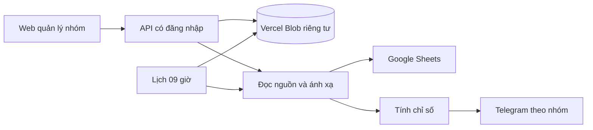

# Quyết định kiến trúc nhóm báo cáo

Trạng thái đã triển khai để kiểm tra bằng hai cấu trúc Sheets do người dùng cung cấp.

Nhu cầu gồm nhiều nhóm báo cáo riêng, cùng bộ chỉ số chi phí, tin nhắn và SĐT nhưng khác tab, vị trí cột và cách biểu diễn ngày. Cấu hình cần thay đổi qua giao diện, tồn tại sau deploy, và được lịch 09:00 sử dụng.

Mỗi nhóm có ID ổn định, tên, trạng thái bật lịch và nguồn theo tháng. Mỗi nguồn có ID file và ánh xạ từng tab. Ánh xạ chứa tên sản phẩm, dòng bắt đầu và cột ngày/chi phí/tin nhắn/SĐT/chi tiêu gốc. Một file dùng cho nhiều tháng có thể đăng ký lại với tab khác. Nguồn cũ được nhập vào nhóm mặc định và giữ bộ đọc tiêu đề trước đây.

Dùng Blob riêng tư vì cấu hình nhỏ, đọc theo tài liệu và project có thể kết nối trực tiếp qua Vercel. Conditional writes với ETag bảo vệ cập nhật đồng thời, đọc `useCache: false` lấy cấu hình mới. Cách này có độ trễ và chi phí đọc/ghi theo dịch vụ. Lịch sử gửi có thể dùng Blob cùng project; Redis được ưu tiên nếu đã cấu hình. Local lưu file riêng để chạy và kiểm tra khi chưa kết nối cloud. PostgreSQL phù hợp khi phát sinh phân quyền nhiều tài khoản hoặc truy vấn phức tạp, nhưng hiện tại sẽ thêm một cơ sở dữ liệu cần vận hành.

Mỗi request đã đăng nhập đọc cấu hình từ kho. Khi lỗi kho, hệ thống báo lỗi và tránh dùng cấu hình cũ âm thầm. Nhóm mới có thể lưu tạm với lịch tắt. Khi lưu nguồn, hệ thống đọc lại Sheets và kiểm tra tháng, tab, cột trùng và ngày trùng. Các công thức tỷ lệ tính từ chỉ số gốc, dữ liệu thiếu được giữ là thiếu. Không đọc tab tổng phí thành chỉ số quảng cáo.

Lịch gửi lấy snapshot danh sách nhóm đã bật, đọc báo cáo từng nhóm và dùng khóa chống trùng riêng. ID nhóm mặc định giữ khóa gửi hằng ngày cũ. Lỗi một nhóm được ghi nhận để các nhóm còn lại tiếp tục. Bộ đọc hỗ trợ bảng tổng hợp mỗi ngày một dòng, tối đa 1000 dòng và 52 cột cho mỗi tab.

Nguồn tham chiếu cho đọc mới và ghi có điều kiện của kho cấu hình là [Vercel Blob SDK](https://vercel.com/docs/vercel-blob/using-blob-sdk).

## Lệnh Telegram và lịch động

Telegram dùng native channel của Eve, xử lý lệnh trong `onMessage` và không mở lượt LLM. Secret webhook xác thực Telegram; kiểm tra chat private và người gửi trùng `TELEGRAM_CHAT_ID` trước khi đọc nhóm hoặc Sheets. Mặc định `/baocao` lấy hôm nay theo giờ Việt Nam, có thể chỉ định ngày và nhóm. `/lich` xem lịch và dẫn về web để sửa.

Cấu hình nhóm có trường `schedule` tùy chọn: bật/tắt, HH:mm, các ngày trong tuần, ngày số liệu và mốc bắt đầu. Dữ liệu cũ được đọc tương thích; chỉ `SEND_REPORTS=true` mới bật lịch mặc định cũ. Sau khi lưu từ UI, lịch của nhóm tự quyết định trạng thái. Một cron mỗi phút kiểm tra lần đến hạn trong vòng 2 giờ. Khóa gửi gồm nhóm, ngày/giờ lịch, loại ngày và đích nhận; sửa lịch không gửi bù mốc trước lúc lưu. Cron mỗi phút yêu cầu Vercel Pro/Enterprise hoặc scheduler tương đương; không tự nâng gói.

Lịch sử gửi ưu tiên Redis nếu đã cấu hình, nếu không dùng Blob riêng tư đã kết nối. Tạo bản ghi pending bằng conditional write trước khi gửi; các tiến trình trùng không gửi thêm. Chỉ lỗi Telegram xác định bị từ chối mới được thử lại. Timeout giữ uncertain; tiến trình chết giữ pending. Đây là lựa chọn tránh gửi trùng khi API Telegram không hỗ trợ idempotency, có thể cần người vận hành kiểm tra và gửi lệnh mới. Blob giữ fingerprint và trạng thái, không lưu toàn văn báo cáo. Không chuyển backend lịch sử khi đang chạy các lần gửi. Nguồn: [Eve Telegram](https://eve.dev/docs/channels/telegram), [Eve dynamic scheduling](https://eve.dev/docs/patterns/dynamic-scheduling), [Vercel Cron limits](https://vercel.com/docs/cron-jobs/usage-and-pricing).
